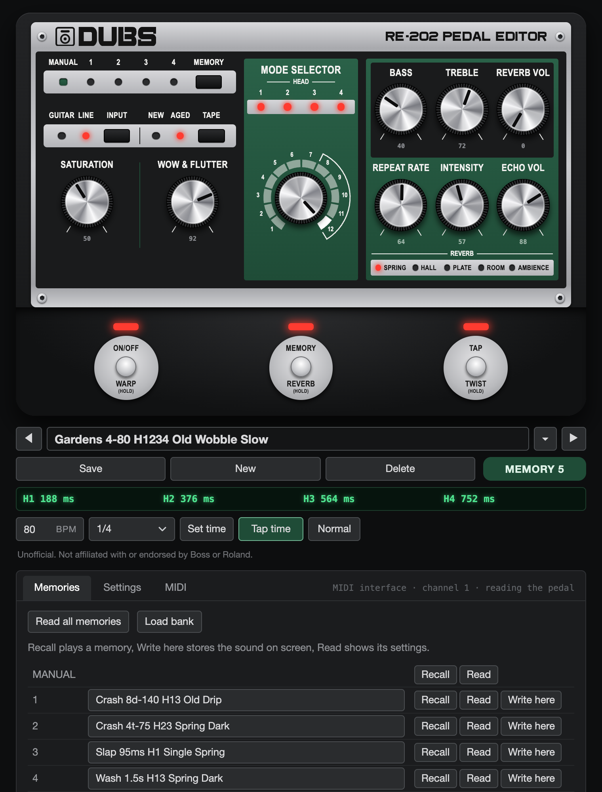

# DUBS: an editor for the Boss RE-202

**DUBS** is a Chrome-based editor for the Boss Space Echo RE-202. It unlocks the pedal's hidden parameters and makes it easy to organize a large preset library.

**Open the editor: https://degiere.github.io/DUBS-RE-202-Editor/**

There are two ways to use it:

- **Online.** Open the link above in Chrome, with nothing to install. The page runs entirely in your browser: your pedal's settings, your presets and your backups stay on your computer, and nothing is uploaded, saved elsewhere or shared.
- **Your own copy.** Download this folder and run it on your computer (see Running it below).

It is one static page of plain JavaScript that talks to the pedal over Web MIDI, straight from your browser to your MIDI interface.


## What you need

- A Boss RE-202, on system Ver. 1.10 for the per-memory reverb type (see System version below).
- Chrome, or another Chromium browser.
- A MIDI interface with 5-pin MIDI OUT and MIDI IN.
- Two TRS **Type A** MIDI cables (see Cables below). One is enough to send edits; the second lets the editor read the pedal.

## Running it

Open https://degiere.github.io/DUBS-RE-202-Editor/ in Chrome. Chrome asks once for permission to use MIDI with SysEx. The page opens on its built-in pedal, a stand-in that sends nothing to hardware and has the presets already in its memories, so you can try everything with no pedal connected. To connect yours, press Find my pedal: the editor asks each MIDI port for an RE-202 and connects to the one that answers. Or pick your interface's ports yourself on the MIDI tab.

To run your own copy, download this folder and start its small server, which needs [Node.js](https://nodejs.org):

```bash
node serve.mjs
```

Then open http://localhost:8772/. Chrome allows MIDI with SysEx only on a page served from `localhost` or over `https`, so opening `index.html` as a file does not work. Chrome treats the online editor and your own copy as separate sites: each asks for MIDI permission and for the library folder on its own.

## Setting up the pedal

Do these once, before the editor can reach the pedal.

1. **Cable it** as under Wiring below.
2. **The pedal's MIDI settings.** Hold [ON/OFF] while plugging in power; once the pedal blinks, let go of the footswitch. Turn [MODE SELECTOR] to the setting, press the [MEMORY] button to change the value, and read it from the lamps. Press [ON/OFF] to leave.

| MODE SELECTOR | Setting | Set it to | Lamps that show it |
|---|---|---|---|
| 6 | RX CH | Channel 1 | Memory 1 + HEAD 1 (MANUAL + HEAD 1 is OFF) |
| 8 | PC IN | ON | MANUAL (memory 1 is OFF) |
| 10 | CC IN | ON | MANUAL (memory 1 is OFF) |
| 9 | PC OUT | ON, for the editor to follow the MEMORY switch | MANUAL |
| 11 | CC OUT | ON, for the editor to follow the knobs | MANUAL |

## Wiring

- Interface **MIDI OUT** → pedal **MIDI IN**: sends edits, presets and program changes.
- Pedal **MIDI OUT** → interface **MIDI IN**: lets the editor read the pedal's settings and memories, back them up, and follow its knobs.

## Cables: the RE-202 is TRS Type A

The RE-202's MIDI jacks are 3.5 mm TRS wired **Type A**. A Type B adapter fits the jack and passes nothing: the pedal ignores every message and never answers. When the pedal ignores MIDI, check the cable before anything else.

Many TRS MIDI adapters are Type B and unmarked. If neither the listing nor the plug says Type A, assume it is not.

## The screen

- **The pedal.** Every knob and button of the hardware. Drag up and down, scroll, or use the arrow keys to turn a knob. A double-click types a value. The Mode Selector's segments click. The MEMORY button steps MANUAL, 1 to 4; to write a memory, use Write here in the Memories list. The three switches along the bottom click for ON/OFF, MEMORY and TAP, and hold for WARP, reverb on/off and TWIST.
- **Reverb type.** Five lamps under the right-hand knobs: SPRING, HALL, PLATE, ROOM, AMBIENCE.
- **Preset bar.** Under the pedal. Name, previous / next, a button that lists every preset (yours, then the presets by family and the music it comes from), Save, New, Delete, and the memory the pedal is on.
- **Head readout.** One green line under the preset bar: each playing head's delay in ms when the tap time is on, or its multiple of head 1.
- **Time row.** Under the readout: BPM, a note value and Set time, which puts the longest playing head on that note; a preset made for a tempo shows its own there. Tap time / Rate knob chooses whether the stored time or the REPEAT RATE knob sets the delay. Normal / Long is the time mode: up to 1 s, or up to 2 s.
- **Drawer.** Three tabs: Memories, Settings and MIDI. At the right of the tab bar, the status line shows the MIDI port, the channel, and whether the editor is reading the pedal or sending only.

In a full-width window the drawer sits beside the pedal, here on the Settings tab:


In half a screen everything stacks, pedal first:



Recalling a memory lights its number in the list and puts its name in the preset bar.

The first Write or Restore of a visit backs up the whole pedal first. With no cable back from the pedal the editor sends only: edits, presets and recalls work, the screen dims after a recall because it cannot see what the pedal loaded, and reading, backup and the Settings tab wait for the cable.


## Library

Pick a folder on the MIDI tab for your presets, backups and memory names, and reopen it there with one click on later visits. Before you pick one, presets and names stay in the browser and backups download. The pedal stores no names: a memory is its knob and switch values only, so names and presets live here.


## Presets

DUBS comes with 96 presets, listed after your own in the preset bar: 12 families of 8. They are a homage to the Roland Space Echo, built around the music it is on record as being used for.

The first six families are for a **line** input: synthesizers, drum machines and the send of a mixing desk, which is how dub was mixed through it. Set the pedal's Input to LINE. With an instrument plugged straight in, leave Direct Sound on: each preset's Echo Vol and Reverb Vol set the mix against the dry signal. On a mixer's send, turn Direct Sound off so only the echo returns. The other six are for **guitar**, with the echo set against the dry signal: Input GUITAR, Direct Sound on. Both are on the Settings tab and apply to every memory.

| Family | For | Music | What it is |
|---|---|---|---|
| Throw | Line | Dub | The send echo: one head, four or five repeats, bass cut, mostly on a dotted 1/8 or a triplet |
| Steppers | Line | Dub | Two and three heads landing on the grid |
| Four | Line | Dub | The fourth head's patterns, Modes 8 to 12 |
| Crash | Line | Dub | Spring reverb pushed forward over a short echo |
| Brink | Line | Dub | Intensity at its ceiling, the feedback held just short of running away |
| Chord | Line | Dub techno | A dotted 1/8 or 5/16 under a chord stab: aged tape, dark, long trails |
| Slap | Guitar | Rockabilly | Slapback: one bright repeat at 60 to 170 ms, bass cut, a little reverb |
| Drive | Guitar | The preamp | Echo off or barely on, Saturation up: the machine as a tone box |
| Chop | Guitar | Reggae | The offbeat chop into the spring, then a short echo on the grid |
| Trip | Guitar | Trip hop | Worn tape at 70 to 90 bpm: dark, hot and wobbling |
| Swell | Guitar | 1990s alternative | Feedback at its ceiling, the Repeat Rate knob played from the expression pedal |
| Wash | Guitar | Long mode | 1 to 2 s, treble and bass rolled off, into Hall, Plate and Ambience |

The original RE-201 of 1974 had three heads, a spring reverb and a head 1 delay of roughly 70 to 180 ms. About half the bank stays inside that. The rest uses what the RE-202 adds: the fourth head, the LONG time mode out to 2 s, and the Hall, Plate, Room and Ambience reverbs.

**Reading a name.** A name is built from the preset's settings: lead word, time, heads, traits. `Waterhouse 4t-150 H3 Old Hot` means a quarter-note triplet at 150 bpm on head 3, aged tape, Saturation high.

- **Time** is the longest playing head's delay. `8d-140` is a dotted 1/8 at 140 bpm, from `16 16d 8 8t 8d 4 4t 5x16`. `110ms` and `1.4s` are free times. `R40` is the Repeat Rate knob at 40 with the tap time off, `R40x2` the same in the LONG time mode.
- **Heads** are the ones playing: `H1`, `H13`, `H1234`.
- **Traits** say where the knobs sit: Dark, Bright, Hot, Wet and the like, with the reverb named when it is up. `Old` is aged tape, `Edge` is Intensity at its ceiling, `Drip` is a lot of spring, and `Only` means the echo is off.
- The lead word is the family, or a place: Gardens, Waterhouse, Kingston, Detroit, Bristol, Oxford.

The expression pedal sweeps Echo Vol from nothing up to the preset's level, like a dub send.

The presets that come with DUBS cannot be deleted or saved over; change one and save it under your own name.

**Load bank**, on the Memories tab, writes the 96 to memories 5 to 100 and names them, with four spring echoes on memories 1 to 4 for the pedal's MEMORY switch. It needs the cable back from the pedal, asks first and backs the pedal up. The pedal's own MEMORY button stops at 4; memories 5 and up are recalled from the Memories tab or by program change.

## System version

Boss's system program Ver. 1.10 adds a reverb type for each memory. An older pedal still works with the editor, with one reverb type for all memories and without the presets that name Hall, Plate, Room or Ambience.

- **Check the version:** hold the [MEMORY] button while plugging in power. MEMORY 3 lit is 1.10; MEMORY 1 or 2 lit is older.
- **Update:** download the system program from Boss and follow the instructions on that page. https://www.boss.info/us/support/by_product/re-202/updates_drivers/b462da5b-e96d-4019-9131-bc4bdca55b68
- **Back up from the MIDI tab first.**

## License

CC BY-NC-SA 4.0. See `LICENSE`. Use it, change it and share it for free with credit to Chris De Giere (https://chrisdegiere.com); anything built from it carries the same license, and neither the editor nor its presets may be sold. Music you make with it is yours.

DUBS is an independent project, not affiliated with or endorsed by Boss or Roland. Boss, Roland, RE-202 and Space Echo are trademarks of their owners.

## About

This project is made with love. Homage to the makers. Hardware and software and music. Please support the makers. --Chris

https://chrisdegiere.com
