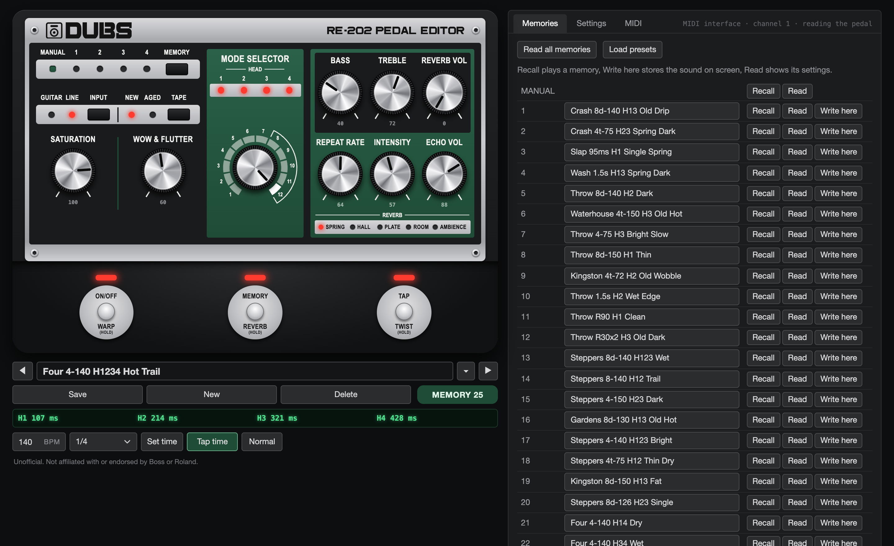
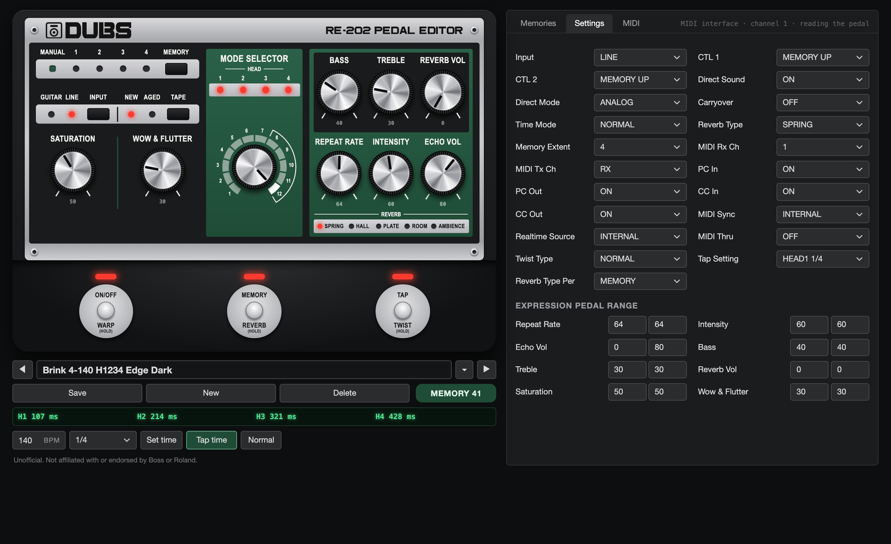

# DUBS: an editor for the Boss RE-202

**DUBS** is a Chrome-based editor for the Boss Space Echo RE-202. It unlocks the pedal's hidden parameters and makes it easy to organize a large preset library.

**Open the editor: https://degiere.github.io/DUBS-RE-202-Editor/**

It is one page of plain JavaScript that runs entirely in your browser and talks to the pedal over Web MIDI. Your pedal's settings, presets and backups stay on your computer; nothing is uploaded or shared.



## What you need

- A Boss RE-202, on system Ver. 1.10 for the per-memory reverb type (see System version below).
- Chrome, or another Chromium browser.
- A MIDI interface with 5-pin MIDI OUT and MIDI IN.
- Two TRS **Type A** MIDI cables (see Wiring below).

## Running it

**Web editor.** Open https://degiere.github.io/DUBS-RE-202-Editor/ in Chrome, allow MIDI when it asks, and press Find my pedal.

**Your own copy.** Download this folder and start its small server, which needs [Node.js](https://nodejs.org):

```bash
node serve.mjs
```

Then open http://localhost:8772/ in Chrome. Opening `index.html` as a file does not work.

## Wiring

- Interface **MIDI OUT** → pedal **MIDI IN**: sends edits, presets and program changes.
- Pedal **MIDI OUT** → interface **MIDI IN**: lets the editor read the pedal's settings and memories, back them up, and follow its knobs.

The RE-202's MIDI jacks are 3.5 mm TRS wired **Type A**. A Type B adapter fits the jack and passes nothing, and many are sold unmarked: if neither the listing nor the plug says Type A, assume it is not. When the pedal ignores MIDI, check the cable first.

## Setting up the pedal

Do this once, before the editor can reach the pedal. Hold [ON/OFF] while plugging in power; once the pedal blinks, let go of the footswitch. Turn [MODE SELECTOR] to the setting, press the [MEMORY] button to change the value, and read it from the lamps. Press [ON/OFF] to leave.

| MODE SELECTOR | Setting | Set it to | Lamps that show it |
|---|---|---|---|
| 6 | RX CH | Channel 1 | Memory 1 + HEAD 1 (MANUAL + HEAD 1 is OFF) |
| 8 | PC IN | ON | MANUAL (memory 1 is OFF) |
| 10 | CC IN | ON | MANUAL (memory 1 is OFF) |
| 9 | PC OUT | ON, for the editor to follow the MEMORY switch | MANUAL |
| 11 | CC OUT | ON, for the editor to follow the knobs | MANUAL |

## The screen

Every knob and button on screen controls the pedal, and moves when you change it on the pedal. Drag, scroll or use the arrow keys to turn a knob, and double-click to type a value. The footswitches hold for WARP, reverb on/off and TWIST.

What the hardware does not have:

- **Reverb type.** The five lamps under the right-hand knobs pick SPRING, HALL, PLATE, ROOM or AMBIENCE.
- **Preset bar.** Your presets, then the ones that come with DUBS. Picking one plays it on the pedal; Save keeps the sound on screen as a preset on your computer. The badge shows the memory the pedal is on, with a star when the sound no longer matches what that memory holds.
- **Head readout.** Each playing head's delay in ms, or its multiple of head 1.
- **Time row.** Set time puts the longest playing head on the note value at the BPM. Tap time / Rate knob picks whether the stored time or the REPEAT RATE knob sets the delay. Normal / Long is up to 1 s or up to 2 s.
- **Memories tab.** Recall plays a memory. Write here stores the sound on screen in that memory, under the name in the preset bar. Read shows a memory's settings.
- **Settings tab.** The pedal's system settings and each knob's expression pedal range.
- **MIDI tab.** Ports, Find my pedal, the library folder, Back up all and Restore.



In half a screen everything stacks, pedal first:


## Library

Pick a folder on the MIDI tab for your presets, backups and memory names; later visits reopen it with one click. Until you pick one, presets and names stay in the browser and backups download. The pedal stores no names, only knob and switch values, so names live here.

## Presets

DUBS comes with 96 presets in 12 families of 8: a homage to the Roland Space Echo and the music made with it.

Six families are for **line** level (synths, drum machines, a mixer's send) and six for **guitar**; set Input to match on the Settings tab. Leave Direct Sound on, or turn it off on a mixer's send so only the echo returns. On most presets the expression pedal brings the echo in, like a dub send.

| Family | For | Music | What it is |
|---|---|---|---|
| Throw | Line | Dub | The send echo: one head, four or five repeats, bass cut, mostly on a dotted 1/8 or a triplet |
| Steppers | Line | Dub | Two and three heads landing on the grid |
| Four | Line | Dub | The fourth head's patterns, Modes 8 to 12 |
| Crash | Line | Dub | Spring reverb pushed forward over a short echo |
| Brink | Line | Dub | Intensity at its ceiling, the feedback held just short of running away |
| Chord | Line | Dub techno | A dotted 1/8 or 5/16 under a chord stab: aged tape, dark, long trails |
| Slap | Guitar | Rockabilly | Slapback: one bright repeat at 60 to 170 ms, bass cut, a little reverb |
| Drive | Guitar | The preamp | Echo off or barely on, Saturation up: the machine as a tone box |
| Chop | Guitar | Reggae | The offbeat chop into the spring, then a short echo on the grid |
| Trip | Guitar | Trip hop | Worn tape at 70 to 90 bpm: dark, hot and wobbling |
| Swell | Guitar | 1990s alternative | Feedback at its ceiling, the Repeat Rate knob played from the expression pedal |
| Wash | Guitar | Long mode | 1 to 2 s, treble and bass rolled off, into Hall, Plate and Ambience |

The original RE-201 of 1974 had three heads, a spring reverb and a head 1 delay of roughly 70 to 180 ms. About half the presets stay inside that. The rest uses what the RE-202 adds: the fourth head, the LONG time mode out to 2 s, and the Hall, Plate, Room and Ambience reverbs.

**Reading a name.** A name spells out the preset: a lead word (the family, or a place), the time, the heads that play, then traits. `Waterhouse 4t-150 H3 Old Hot` is a quarter-note triplet at 150 bpm on head 3, with aged tape and Saturation high.

**Load presets**, on the Memories tab, puts all 96 on the pedal in memories 5 to 100, with four spring echoes in 1 to 4. The pedal's MEMORY button only reaches 1 to 4; recall the rest from the Memories tab or by program change.

## System version

Boss's system program Ver. 1.10 adds a reverb type for each memory. An older pedal still works with the editor, with one reverb type for all memories and without the presets that name Hall, Plate, Room or Ambience.

- **Check the version:** hold the [MEMORY] button while plugging in power. MEMORY 3 lit is 1.10; MEMORY 1 or 2 lit is older.
- **Update:** download the system program from Boss and follow the instructions on that page. https://www.boss.info/us/support/by_product/re-202/updates_drivers/b462da5b-e96d-4019-9131-bc4bdca55b68
- **Back up from the MIDI tab first.**

## License

CC BY-NC-SA 4.0. See `LICENSE`. Use it, change it and share it for free with credit to Chris De Giere (https://chrisdegiere.com); anything built from it carries the same license, and neither the editor nor its presets may be sold. Music you make with it is yours.

DUBS is an independent project, not affiliated with or endorsed by Boss or Roland. Boss, Roland, RE-202 and Space Echo are trademarks of their owners.

## About

This project is made with love. Homage to the makers of hardware and software and music. Please support the makers. --Chris

https://chrisdegiere.com
